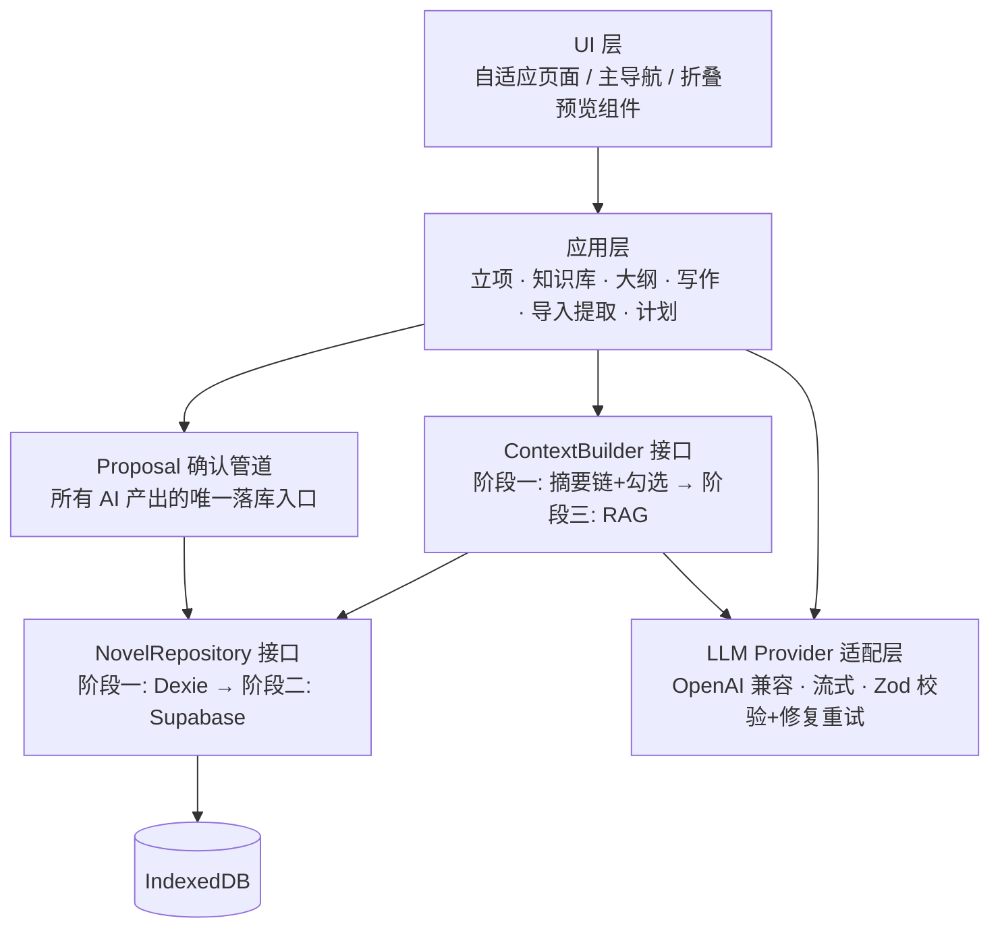
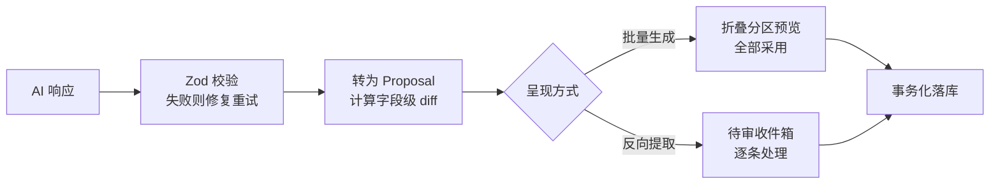
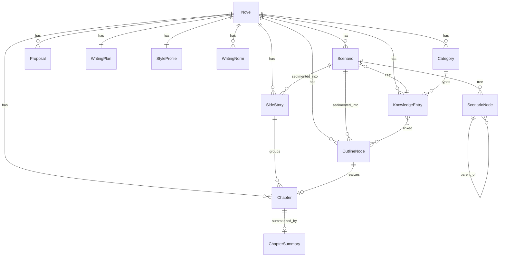

# 设计方案 — AI 小说创作助手（自适应 Web）

> 项目代号：MyLiterature
> 文档状态：阶段一（本地优先）设计定稿
> 最后更新：2026-09-19

---

## 1. 问题陈述

一个自适应的小说创作 Web 应用，手机与电脑同一套代码。核心闭环：

**一句话点子 → AI 生成世界观 / 人物 / 大纲构成的知识库 → 基于知识库按章续写 → 按计划推进**

已有旧稿可导入并反向提取设定，补全知识库后无缝续写。**所有 AI 产出必须经用户确认方可落库**，这是产品的第一原则，也是架构上的硬约束。

---

## 2. 需求确认

以下决策均已与用户逐项确认：

| #   | 议题                         | 决策                                                                        |
| --- | ---------------------------- | --------------------------------------------------------------------------- |
| 1   | 技术栈与数据位置             | 阶段一纯前端 + IndexedDB，无账号；阶段二迁 BaaS 云同步                      |
| 2   | LLM 密钥模式                 | 阶段一用户自带 API Key（存本地）；阶段二转服务端代理                        |
| 3   | 长篇上下文策略               | 摘要链 + 手动勾选关联条目；阶段三加 RAG                                     |
| 4   | 阶段一是否加 serverless 代理 | 不加，保持零后端                                                            |
| 5   | AI 产出确认交互              | 整体预览 + 局部编辑；大批量生成用可折叠分区 + 分区重生成 + 底部「全部采用」 |
| 6   | 知识库结构                   | 内置三大类（世界观 / 大纲 / 人物）+ 用户自建分类与自定义字段                |
| 7   | 反向提取冲突处理             | 待审收件箱，逐条决定 新增 / 合并到已有 / 忽略                               |
| 8   | 写作计划提醒能力             | 仅应用内（今日目标、进度、连续打卡），不做推送通知                          |
| 9   | 正文写作粒度                 | 双轨：整章草稿生成 + 编辑器内段落级 续写 / 改写 / 扩写                      |
| 10  | 导出格式                     | 剪贴板 + Markdown / TXT（单章 / 全书），不做 EPUB / Word                    |
| 11  | 主力模型                     | DeepSeek                                                                    |
| 12  | 风格能力                     | 可选 网络文学 / 严肃文学 / 类型文学，以及历史知名文学家风格                 |

---

## 3. 研究结论（已核实官方文档）

### 3.1 结构化输出能力在各家之间不一致

- OpenAI 支持 `response_format: { type: "json_schema" }` 的严格模式，保证输出贴合给定 JSON Schema。
- DeepSeek 只提供 `json_object`：保证输出是**合法 JSON**，但**不保证字段符合预期 schema**。

**结论**：校验责任必须落在客户端。Zod 作为唯一事实源；能下发 JSON Schema 的 provider 就下发，不能的就把 schema 说明内嵌进 prompt；收到响应后**一律 Zod 校验**，失败则携带校验错误信息做一次「修复重试」。不得假设模型输出可信。

### 3.2 DeepSeek 当前规格

| 项                      | 值                                                         |
| ----------------------- | ---------------------------------------------------------- |
| 模型                    | `deepseek-flash`（DeepSeek-V4.1-Flash）、`deepseek-v4-pro` |
| base_url（OpenAI 格式） | `https://api.deepseek.com`                                 |
| 上下文长度              | 1M                                                         |
| 最大输出                | 最高 384K                                                  |
| Json Output             | 两者均支持（`json_object` 级别）                           |
| Tool Calls              | 两者均支持                                                 |
| thinking 模式           | `thinking: { type: "enabled" }` + `reasoning_effort` 切换  |
| 输入价格（flash，低峰） | cache hit $0.003/1M，cache miss $0.15/1M                   |
| 输出价格（flash，低峰） | $0.6/1M                                                    |

### 3.3 由此得出的四条设计约束

1. **上下文窗口不是瓶颈**。装箱策略保留，但目标从「塞得进去」改为「控成本 + 避免长上下文稀释模型注意力」，并向用户透明展示注入量。
2. **必须命中 prompt 缓存**。cache hit 与 cache miss 的输入价差达 50 倍，因此稳定内容必须放在 prompt 前缀且**顺序字节级可复现**（system + 风格档案 + pinned 世界观 + 关联人物），易变内容（最近章摘要、上一章结尾、本次指令）一律拼在尾部。`ContextBuilder` 的返回值因此拆成 `stablePrefix` 与 `volatileSuffix` 两段。
3. **thinking 按任务分配**。大纲规划、世界观构建、反向提取等结构化推理任务开 thinking（`reasoning_effort: high`）；正文续写关闭 thinking，文风更连贯、更快、更省。
4. **输出上限 384K**，整章生成不会被截断，无需分段拼接。

成本量级：一章三千字中文的输出费用在低峰期约合几分钱人民币以内，输入在缓存命中时接近免费。中文的字 / token 比例未实测，仅为量级估计，但可以确定**成本不是本产品的约束条件**。

---

## 4. 关键约束

### 4.1 两次演进必须免改业务代码

阶段一 → 阶段二（云同步）、阶段一 → 阶段三（RAG）都不应触碰业务逻辑。因此两个接口从第一行代码起就抽象：

- `NovelRepository`：阶段一 Dexie 实现 → 阶段二 Supabase 实现
- `ContextBuilder`：阶段一摘要链实现 → 阶段三 RAG 实现

### 4.2 本地 API Key 的安全边界

API Key 存在浏览器本地，**可被任何同源脚本读取**。阶段一（自用）可接受，但必须做到：

- 设置页明示风险
- 不引入任何第三方分析 / 广告脚本
- 配置严格 CSP，`connect-src` 白名单化
- Key 独立存储，**不参与任何备份导出**

### 4.3 IndexedDB 的数据丢失风险

浏览器可能回收 IndexedDB 数据（iOS Safari 对未添加到主屏的站点有存储清理策略，具体行为随版本变化，未实测）。因此「导出备份」不是可选功能，而是数据安全底线，需在 UI 上主动引导。

---

## 5. 分层架构



### 目录结构约定

```
src/
  app/            应用外壳、路由、底部 Tab
  domain/         Zod schema、实体类型、纯领域逻辑
  data/           NovelRepository 接口 + Dexie 实现 + 迁移
  llm/            Provider 适配层、SSE 解析、结构化输出与校验重试
  prompt/         prompt 模板、风格 rubric 库、稳定前缀组装器
  context/        ContextBuilder 接口 + 摘要链实现 + 装箱算法
  proposal/       Proposal 模型、diff 计算、确认管道
  features/       各功能模块（立项 / 知识库 / 大纲 / 写作 / 导入 / 计划 / 导出）
  ui/             通用组件（自适应：窄屏移动端形态、宽屏桌面形态）
```

---

## 6. 核心机制：Proposal 确认管道

需求「一切自动生成都要用户确认」如果靠各功能自行实现，必然有遗漏。做法是把它变成架构约束：

> **所有 AI 产出一律不直接写库**，先转成 `Proposal`，再经统一的预览确认 UI 落库。

`Proposal` 携带三种意图：

| action    | 语义                     | 典型来源                     |
| --------- | ------------------------ | ---------------------------- |
| `create`  | 新建条目                 | 立项生成、反向提取出全新人物 |
| `merge`   | 合并进已有条目（字段级） | 反向提取命中已有条目         |
| `replace` | 整体替换已有内容         | 段落改写、章节重写           |

立项生成、大纲扩写、章节生成、段落改写、摘要生成、反向提取、风格提炼**全部复用这一条路径**。待审收件箱与「全部采用」只是同一管道的两种前端呈现：



这样做的收益：确认逻辑只有一份实现，新增 AI 功能自动获得确认能力，不可能绕过。

---

## 7. 数据模型



### 实体要点

**Novel** — `title` / `oneLiner` / `genre` / `pov` / `targetLength` / 时间戳

**Category** — `builtin` 标记 + `fieldTemplate[]`。内置世界观 / 大纲 / 人物三类预置字段模板；用户可新建「势力 / 地点 / 道具 / 时间线 / 伏笔」等分类并自定义字段。字段定义 `FieldDef` 可带 `mutability: 'locked' | 'mutable'`（v7 新增，可选、无默认值，旧分类 parse 后形状不变），决定互动推演里世界线能否改写这一栏；它不进任何现有提示词。

**KnowledgeEntry** — 知识库的基本单位

- `categoryId`：所属分类，决定字段模板
- `title`：条目名
- `aliases[]`：别名，**反向提取做名称匹配的关键**
- `fields: Record<string, string>`：跟随分类字段模板的内容
- `pinned`：是否每次生成都必须注入
- `sourceChapterIds[]`：来源章节溯源
- `version`：版本号，合并时递增
- `deletedAt`：软删除标记，支持恢复
- `scope`：作用范围（IndexedDB v7 新增）。`{ kind: 'universal' }`（默认）或 `{ kind: 'limited', targets: [{ scenarioId, fromNodeId, revealHint }] }`：只在列出的推演里存在，`fromNodeId` 非空时只在那个节点及其后代可见，`revealHint` 非空时在被某步标为「登场」之前只作为「可能登场的预设」注入。**仓储 `listEntries` 默认 `scope: 'worldview'`，只返回通用条目**：现有写作链路不传参就看不到限定条目，新增的调用点忘了传参也不会泄漏（失败关闭）；知识库页、回收站、收件箱、推演显式传 `'all'`。`findEntryByName` 只匹配通用条目
- `fieldLocks: Record<字段键, 'locked' | 'mutable'>`：逐字段覆盖分类模板的可变性（v7 新增，默认 `{}`）。解析顺序 `fieldLocks[key]` → `FieldDef.mutability` → `builtinMutability(category, key)`（内置分类按 `kind`，预置分类按「名称 + 键」双重匹配）→ `mutable`。旧分类不存 `mutability`，靠第三步得到默认值，所以不迁移分类表
- 作为某推演主角的条目不能硬删除（仓储 `hardDeleteEntry` 拒绝），否则推演无主角、备份也过不了校验

**OutlineNode** — `parentId` + `order` 支持卷 / 章层级，`title` / `synopsis` / `targetWords` / `status` / `linkedEntryIds[]` / `scenarioSource: { scenarioId, nodeIds } | null`（v7 新增：只有沉淀出的**章级**节点非空，卷只是分组；「来自旧主线」由 `sedimentCoverage` 现算 —— `nodeIds` 不全在当前主线上 —— 不存标记）

**Chapter** — `outlineNodeId?` / `index` / `title` / `content` / `wordCount` / `status` / `source`（`ai` / `imported` / `manual`）

- `sourceContent` / `sourceLanguage`：翻译前的原文与其语种。翻译是不可逆的破坏性操作，而机器译文一定有需要回头核对原句的地方，所以原文必须留一份。空串表示这一章没被翻译过；它不参与字数统计、不进 prompt
- `scenarioSource: { scenarioId, nodeIds, brief } | null`（v7 新增）：只允许外传章节非空，`brief` 是沉淀时的本章细纲；主线章节的溯源在大纲节点上，两处都有会不一致
- `sideStoryId`：`null` 是主线，否则指向所属外传（IndexedDB v5 新增并建索引，旧章节迁移时补 `null`）。`index` 在**每条线内**各自从 1 编号。外传章节的 `outlineNodeId` 恒为 `null`；`sideStoryId` 不能经 `updateChapter` 修改（仓储静默剥掉），跨线移动不在范围内

**SideStory** — 外传，一部一行（IndexedDB v5 新增）

- `title`（1–40 字，本书内唯一；存之前去掉「外传·」前缀，比较时忽略大小写）/ `synopsis`（≤ 2000 字，写外传时交给模型）/ `order` / `rollingSummary`（这部外传自己的进展摘要）
- **外传仍住在 `chapters` 表里，不另开一张表**。编辑器、翻译、段落加工、自动摘要、译名一致性检查、备份都围绕 `Chapter` 实现，另开一张表这些全得复制一份，两份必然漂移。区分两条线只需要一个外键
- **`chaptersOfTrack(chapters, sideStoryId)` 是唯一按线过滤的入口**（`src/domain/sideStory.ts`）。上下文构建、摘要链的伏笔承接、导出、统计、导入编号都只从这里取「哪些章节算同一条线」；同一个判断写在五个地方，必然有一处漏掉。`listChapters` 仍返回全量，因为译名检查、备份、文风取样都需要全部章节，改成默认只返回主线等于让这三处悄悄漏掉外传
- `scenarioSource: { scenarioId, forkNodeId } | null`（v7 新增）：从推演沉淀出的外传记住分叉节点（与沉淀时主线最深的公共节点）。「追加到外传」不比较它，而看当前节点是否在外传最后一个带溯源章节的最后一步的子树里 —— 主线一换，重新算出的分叉点就变了
- 删除外传在一个事务里连带删掉它的章节和章节摘要。`computeStats` 的 `chapterCount` / `doneChapterCount` 只算主线，`sideChapterCount` 单列，`wordCount` 含外传（备份提醒不能漏掉这部分）

**ChapterSummary** — 摘要链的载体

- `summary`：本章摘要
- `keyEvents[]`：关键事件
- `appearingEntryIds[]`：出场条目，用于下一章预选勾选项
- `openThreads[]`：未收束伏笔，长篇防漂移的关键

**Proposal** — `origin`（`generate` / `extract` / `refine`）/ `action` / `targetEntryId?` / `payload` / `diff` / `sourceRef` / `status`

**WritingPlan** + `DailyLog` — 计划配置与每日产出日志

**ImportJob** — 旧稿导入的断点续跑载体（IndexedDB v2 新增，一书一份）

- `batchId`：本次导入所有提案共用的批次号，摘要与条目提案因此落在同一个收件箱
- `destination`：`null`（还在分章 / 翻译阶段）或 `{ kind: 'main' }` / `{ kind: 'side', sideStoryId }` / `{ kind: 'worldview' }`。它替代了原来的 `importType`
- `drafts[]`：选定目的地之前的分章草稿与译文（含原文、语种、逐章翻译状态）。这期间一章 `Chapter` 都不写；草稿只经仓储的 `patchImportDrafts` 按章合并进库里最新那一行，已译（`done`）的章不可降级，旧实例迟到的写回因此不会冲掉译文
- 阶段写入只有三个入口，都在事务里先检查 `destination !== null` 即拒绝：`saveImportDrafts`（分章确认）、`commitImportChapters`（主线 / 外传：章节与任务推进同成同败，编号在事务内按本线最大章号接续）、`commitImportWorldview`（只开 `importJobs` 一张表，草稿按章打包成提取段，从头到尾不碰 `Chapter`）
- `chapters[]`：每章的 `chapterId` / 状态 / 错误信息
- `worldviewChunks[]`：世界观目的地的提取段（带章节标题），几个短章合成一段、超长章按段落再切，每段 ≤ 6000 字
- `entryDrafts[]`：跨章累计合并的条目草稿，全部跑完才 materialize 成提案
- `openThreads[]` / `rollingSummary`：随提取推进的累计伏笔与全书进展
- `withStyle`：是否在收尾时顺带从稿件归纳文风（在「导入到」里选；主线默认开、外传默认关，世界观恒为关）。外传导入的收尾不出 `novel` 进展提案，改出 target 为 `sideStory` 的外传进展摘要提案
- **一书一份，但可以连着跑多轮**：收尾时任务即删，所以第二批素材进来时是一个新任务、新批次号。作品级的译名表与已有条目跨轮沿用 —— 同一个人物在第二批里走「合并」而不是新建
- **为什么目的地要在翻译之后选**：用户原话是「世界观设定也可能是以故事的形式」。一段前史、一篇人物小传读起来和正文没有区别，外文稿在翻译之前判断不了它该进主线、外传还是只当设定参考。所以流程统一为 粘贴 → 分章 →（有外文时）翻译 → 导入到 → 提取 → 确认，纯中文稿把「导入到」直接放在分章页、不多一步。代价是翻译不能再挂在 `Chapter` 上（那时还没有章节），于是草稿和译文落在任务上；按量级算整份放在一行里没有问题，生命周期也和任务一致。顺带的好处是世界观设定也能翻译、沿用作品译名表，提取时模型看到的是中文
- **旧任务兼容**：`upgradeLegacyImportJob` 是全函数（不调 Zod、对任何输入都不抛错），v5 迁移和 `ImportJobSchema` 的 `z.preprocess` 共用这一份换算；旧 `importType: 'worldview'` 换成世界观目的地，旧章节任务换成主线。换算不了的行在面板加载时由 `safeParse` + `resumeStepOf` 清掉，章节不受影响

**StyleProfile** — 见第 8 节

**WritingNorm** — 作品级写作规范，一书多份，一份一行（IndexedDB v6 新增，只加表、无 upgrade）

- `title`（1–60 字）/ `content`（非空，≤ 60000 字，**不 trim**，作者原文直接落库，不走提案）/ `enabled` / `scopes[]`（`writing` / `planning` / `summary` / `extract` / `check` / `interactive` 多选，默认全开，仓储去重并按固定顺序存。`interactive` 是 v7 加的：迁移与 v1–v3 备份导入共用 `addInteractiveScopeIfFull`，只给恰好五项全开的老规范补上，收窄过的不动）/ `order`
- **单独成表，不挂在 `StyleProfile` 或 `Novel` 上**：要逐份启用、排序、按任务选作用范围，还可能很长；塞成数组每改一份都要整行重写，备份合并也只能整本覆盖。与 `SideStory` 同理
- **`normsInScope(norms, scope, excludedIds?)` 是唯一的注入过滤入口**（`src/domain/writingNorm.ts`）：启用 + 作用范围含 scope + 正文非空，按 `order → createdAt → id` 全序排序。没有可注入的规范时各任务的提示词逐字节不变
- 顺序只经 `reorderWritingNorms` / `saveCondensedWritingNorm` 改；AI 精简另存与停用原文在一个事务里同成同败
- 翻译不注入规范：忠实优先，规范会诱导模型「修正」原文

**Scenario** — 互动推演，一书多个（IndexedDB v7 新增 `scenarios` 表）

- `title`（1–40 字）/ `setup`：`cast[]`（第一期恰好 1 人，数组为多主角留口）、`start`（时间 / 地点 / 处境）、`goals[]`（1–6 个，好 / 坏 / 中性）、`milestones[]`（0–8 个）、`tone`、`expectedSteps`（5–200）。开局后主角与起点不可改（`updateScenario` 只接受目标、里程碑、基调、预计步数）
- `mainNodeId`：主线 = 根到它的路径，**只在推进的同一事务里改成新节点**；`cursorNodeId`：断点续玩，跳转只改它。存显式指针而不是现算 `max(createdAt)`：合并导入后两台设备的时钟可能不一致
- 删推演在一个事务里删全部节点、清掉所有指向它的 `scenarioSource`，可选把只限定到它的条目软删除
- v7 的 `upgrade` 给旧行补默认值（条目 `scope` / `fieldLocks`，大纲 / 章节 / 外传 `scenarioSource: null`，五项全开的规范补 `interactive`）：读取路径不做 Zod parse，与 v3 / v5 同理，比在每个读取点写 `?? 默认值` 可靠

**ScenarioNode** — 推演的一步（v7 新增 `scenarioNodes` 表，索引 `scenarioId` / `parentId`）

- `parentId`（根为 null，每个推演恰好一个根）/ `depth`（= 父 + 1，界面上「第 k 步」= depth + 1）/ `arrivedBy`（`start` / `option` + optionId / `free` + 原文 / `wrap-up` + 想要的目标）/ `plot` / `challenge` / `options[]`（AI 当时给的原样保存，≤ 8，`batch` 区分「再给几个选项」追加的批次）/ `delta` / `notices[]`（被丢弃的变化，给作者看）/ `progress` / `ending` / `pathSummary`（只有 depth % 5 === 4 的检查点有）/ `deltaEditedAt`
- **树是唯一事实源**：主线、外传线、「已走过」（某选项下已有子节点）都从树上现算，不存标记，存了就会和树漂移（例如合并导入只带来了子节点）。同一节点每个选项 / 每个规范化后的自由输入 / 收尾最多一个子节点，由仓储事务保证（两个标签页同时点同一选项时只有事务挡得住）

**WorldlineDelta** — 节点上的世界线差异：`fieldOverrides[]`（只能改模板字段）/ `lineEntries[]`（本线新条目，`promotedEntryId` 非空 = 已提升）/ `statusChanges[]`（登场、死亡、失踪、被俘、被毁、被封印、恢复如常）/ `ocChanges[]`（按 `castId`）/ `events[]` / `flags[]`

- 引用用 `EntryRef`：`{ kind: 'world', entryId }` 或 `{ kind: 'line', nodeId, localId }`，存 id 不存名称 —— 条目改名、加别名后本线改写仍对得上。模型产出用名称，解析成 id 只在落库前发生一次
- **有效知识不存储**：`effectiveKnowledge(scenario, path, entries, categories)`（`src/domain/worldline.ts`，纯函数）= 可见条目原文 + 根到节点沿路叠加的差异，后写覆盖先写。沿树继承、兄弟隔离是这个定义的直接结果；存了就会和祖先差异的编辑漂移
- **`sanitizeDelta` 是唯一的过滤规则**：锁定字段、找不到的条目、模板外字段、世界规则类条目的处境变化、重名新条目一律丢弃。生成管道落库前调用（丢弃并记 `notices`），仓储写入时再调用（手动编辑有任何提示就抛错不写）
- 已提升的本线条目在有效知识里是指向那条世界观条目的别名：原线后续的改写继续作用在它身上，兄弟分支看到的是世界观原文

**LLMSettings** — 独立存储，标记 never-export

**Glossary** — 作品级译名表，一书一份（`&novelId`）

- `terms[]`：`原文名 → 中文译名`
- **刻意不挂在导入任务上**。任务只为断点续跑而存在、跑完即删，而「Ashford 译作阿什福德」是作品的永久事实 —— 第二批外文素材进来时必须沿用同一译法
- 两套合并语义：模型产出走**先到先得**（已定的不被推翻），用户显式修改走**覆盖**。两者都在仓储层执行，保证不变量只有一个入口
- 一致性检查 `findGlossaryDrift(terms, chapters)`：靠 `Chapter.sourceContent` 与 `content` 对照 —— 原文含该专名、译文不含当前译名的章节就是没跟上。**不记录译名的历史版本**，改名后自然被标出，且能顺带发现模型没照译名表译的情况

**RepositorySnapshot** — 备份用的全量快照，逐表列出上述实体（不含 `LLMSettings`）。备份文件是外部输入，落库前整份过 Zod，导入走单个事务。备份文件版本为 4（v2 加了 `sideStories`，v3 加了 `writingNorms`，v4 加了 `scenarios` / `scenarioNodes`、条目的 `scope` / `fieldLocks`、大纲 / 章节 / 外传的 `scenarioSource` 与规范的 `interactive` 作用范围）；v1–v3 文件照常能读，v1 的章节一律视为主线，缺的新字段取默认值（通用、无锁定覆盖、无溯源、无推演），v1–v3 的规范按 `addInteractiveScopeIfFull` 补作用范围（v4 文件不补：v4 里只有五项的规范是作者主动去掉了 `interactive`）。每次升版本都是同一个理由：旧版应用的 `z.object` 会悄悄丢掉未知字段（v3 的规范、v4 的推演），恢复「成功」但数据没了，而 `interactive` 作用范围会让旧应用整份拒绝、却报成「内容不符合预期」；升版本后旧应用会明确报「来自更新版本」。`superRefine` 拒绝指向不存在外传、跨作品引用外传或关联了大纲节点的外传章节，v4 再加推演树的完整性检查：节点属于快照内同作品的推演、每个推演至多一个开局、父节点存在且层级连续、`option` 指向父节点上的选项、结局之后没有节点、主线 / 落点指针属于本推演、主角条目存在、`scenarioSource` 指向的步骤属于对应推演且章节级溯源只在外传章节上、同一选择至多一个子节点 —— 备份是唯一能绕过仓储写入的入口，所以在入口处再验一遍。合并导入对快照里的每个推演**整棵替换**节点（逐行取并集会把两份各自合法的树拼成不合法的），替换后在同一事务里用 `pruneScenarioRefs` 清掉本地行里指向已删节点的 `scenarioSource` 与 `fromNodeId`，否则合并后导出的备份恢复不了。

---

## 8. 风格档案（StyleProfile）模块

三个正交维度，每本小说一份，可随时切换微调，作为 prompt 稳定前缀的一部分。

### 维度一 · 文体取向

| 取向     | 子类                                           | 写作约定                                         |
| -------- | ---------------------------------------------- | ------------------------------------------------ |
| 网络文学 | 都市 / 玄幻 / 仙侠 / 科幻 / 悬疑 / 言情 / 历史 | 黄金三章、章末钩子、爽点密度、单章 2000–3000 字  |
| 严肃文学 | —                                              | 主题先行、意象与留白、内心视角、容许非线性结构   |
| 类型文学 | 推理 / 科幻 / 武侠 / 恐怖 / 历史               | 强调类型公约：推理的线索公平性、科幻的设定硬度等 |

### 维度二 · 创作方法论（决定大纲生成的结构模板）

- **网文节奏结构** — 黄金三章 + 单元副本 + 阶段爆点
- **三幕式** — 建置 / 对抗 / 解决
- **雪花法** — 逐层细化，天然契合「大纲节点 AI 扩写」
- **英雄之旅** — 十二阶段
- **起承转合 / 章回体** — 中式叙事结构

### 维度三 · 名家风格参考（可选 0–2 位，带 0–100 强度滑杆）

内置风格库，每位作家是一组**可读可编辑的风格特征描述**（rubric），而非作品文本。rubric 维度：

- 句式长度分布
- 意象与物象偏好
- 叙述距离（全知 / 贴身 / 冷眼旁观）
- 对话占比与对话风格
- 修辞习惯
- 词汇色彩与语域

首批内置：鲁迅、张爱玲、老舍、沈从文、曹雪芹、金庸、古龙、海明威、契诃夫、卡夫卡、马尔克斯。

**边界说明**：范围限定在已故经典作家（公共领域）；做的是风格特征的结构化描述，不复制原文。文学风格本身不受版权保护，但成品对外不宜宣称与某作家的关联 —— 这一点在 UI 上以一行说明提示。

### 文风取样

两个来源，同一套 rubric、同一条确认管道：

- **手动取样**：用户贴一段喜欢的文字，AI 提炼成自定义风格档案（`features/style/styleSample.ts`）。语义是「我想写成什么样」。
- **从旧稿归纳**：导入流程收尾时自动取样几段代表性片段，产出 rubric 七维 **+ 文体取向 + 子类**（`features/import/extractStyle.ts`）。语义是「我本来就写成什么样」—— 对存量作者，这才是默认值。

两者都只产出提案，落库仍走 `styleProfile:replace`。

**自动归纳的边界**：只认能从文本观察出来的属性。**创作方法论**是「接下来怎么规划大纲」的选择而非文本属性，且直接决定后续大纲结构，猜错代价不对称；**名家风格参考**是「我想像谁」而非「我像谁」，且数组套对象无法用 `FieldSpec` 表达字段级 diff。两者一律不自动设。

**取样规则**（`sampleManuscript`，纯函数、完全确定性）：跳过过短的章（目录 / 卷标题）→ 章数多于所需时让出开篇（楔子语感不代表全书）→ 等距取最多 3 章 → 每章取中段并对齐句子边界 → 总长卡在 4000 字。不用随机数：同一份稿件每次取样必须逐字节一致，否则 prompt 缓存失效、测试也不可重复。

### 生效点

| 环节     | 风格档案的作用               |
| -------- | ---------------------------- |
| 立项生成 | 影响世界观取向与人物塑造方式 |
| 大纲生成 | 方法论决定结构模板           |
| 正文写作 | 作用最强，rubric 直接注入    |
| 段落改写 | 可临时指定「按 X 风格改写」  |

---

## 9. 续写上下文装箱策略（阶段一）

按优先级填入预算，超预算时从低优先级开始降级。**第 1–5 项构成 `stablePrefix`（保证顺序与内容稳定以命中 prompt 缓存），第 6–8 项构成 `volatileSuffix`**：

| 优先级 | 内容                                                                                            | 所属段       |
| ------ | ----------------------------------------------------------------------------------------------- | ------------ |
| 1      | 小说元信息（体裁、基调、人称视角）                                                              | stablePrefix |
| 2      | 风格档案（文体取向 + 方法论 + 名家 rubric + 强度）                                              | stablePrefix |
| 3      | 写作规范（启用且作用范围含「写正文」的，按 `order` 排序；不参与预算裁剪，生成面板里可临时取消） | stablePrefix |
| 4      | `pinned` 的世界观核心条目                                                                       | stablePrefix |
| 5      | 关联条目（有默认预选，用户可增删勾选；见下）                                                    | stablePrefix |

**默认预选的四个来源**，分显式与推断两档，显式排前（装箱顺序即优先级，预算紧张时先丢推断的）：

| 档   | 来源                                                     |
| ---- | -------------------------------------------------------- |
| 显式 | 大纲节点的 `linkedEntryIds`                              |
| 显式 | 上一章摘要的 `appearingEntryIds`                         |
| 推断 | 大纲节点的**标题与梗概**里提到的条目名（本地匹配）       |
| 推断 | 上一章摘要的**正文与关键事件**里提到的条目名（本地匹配） |

推断来源有数量上限（`MAX_INFERRED_ENTRIES = 8`），显式来源不受限。核心设定一律不进预选 —— 它们始终注入，出现在可勾选列表里会让用户误以为能取消。
| 6 | 全书滚动进展摘要（一段） | volatileSuffix |
| 7 | 最近 N 章摘要（N 默认 3，可调） | volatileSuffix |
| 8 | 上一章结尾原文 500–800 字（保语气衔接）+ 本次指令 | volatileSuffix |

写作规范排在核心设定之前：规范写好后很少改，核心设定会随知识库确认增减。放在前面，确认新的核心设定不会让规范那几千 token 失去缓存。

生成前展示「本次将注入 X 条设定 / 约 Y tokens」，让消耗与依据对用户透明，并允许即时裁剪。

**来自推演的章节**（`ContextRequest.scenarioContext`，只由 `ChapterEditorScreen` 传给整章生成）：在 volatileSuffix 的大纲位置 / 外传说明之后、【故事至此】之前按顺序插入四块 —— 推演专属设定（限定条目原文，取本章最后一步处可见的、本章碰过或提到的）、分叉之前的经过（仅外传）、本章依据的推演原文、本章开始时的世界线状态 + 本章内的变化。都标为必选、不参与预算裁剪，清单 `kind: 'scenario'`。通用主角（`castEntryIds`）并入显式预选档，外传细纲与步骤原文（`hintText`）并入名称匹配的推断来源。不传 `scenarioContext` 时构建器一行都不多走，`noScenarioBaseline.test.ts` 守住逐字节不变。

### 互动推演的装箱顺序

推演一步是一次流式调用（正文在前、`@@@STATE@@@` 分隔符之后是 JSON 尾部），装箱与写作链路同一原则：系统提示在同一推演内**所有步骤、所有分支、收尾、再给选项、前情摘要逐字节相同**。

| #   | 内容                                                                                                                                        | 所属段   |
| --- | ------------------------------------------------------------------------------------------------------------------------------------------- | -------- |
| 1   | 开场白（叙事导演兼执笔者）                                                                                                                  | 系统提示 |
| 2   | 作品信息 + 文体 + 结构方法 + 文风（`composeStylePrefix`）                                                                                   | 系统提示 |
| 3   | 写作规范（作用范围含 `interactive`），排在核心设定之前                                                                                      | 系统提示 |
| 4   | 核心设定：通用的 pinned + 限定到本推演、整推演可见、无登场条件的 pinned（排除主角），锁定字段标「（底层，不可改变）」                       | 系统提示 |
| 5   | 主角的世界观原始设定                                                                                                                        | 系统提示 |
| 6   | 开局与目标：起点、G1…Gn、M1…Mn、基调、预计步数                                                                                              | 系统提示 |
| 7   | 推演规则（防发散、防强行转折、自由输入是尝试）                                                                                              | 系统提示 |
| 8   | 本线相关设定：差异碰过的条目（显式，≤ 12）+ 最近原文 / 本次行动 / 前情里提到的条目（推断，≤ 8，作者可在「本步依据」里取消）的**世界观原文** | 用户提示 |
| 9   | 可能登场的预设：有登场条件、尚未登场的限定条目                                                                                              | 用户提示 |
| 10  | 本线变化：根到父节点的累计差异（「与上文冲突时以这里为准，底层字段除外」）                                                                  | 用户提示 |
| 11  | 更早的经过：最近的检查点摘要 + 未收束线索                                                                                                   | 用户提示 |
| 12  | 此前几步（简）：检查点与最近几步之间的步骤                                                                                                  | 用户提示 |
| 13  | 最近 3 步：行动、情节原文、当时的挑战                                                                                                       | 用户提示 |
| 14  | 导演提示：第几步 / 阶段、已达成与下一个里程碑、超出预计步数时的约束                                                                         | 用户提示 |
| 15  | 本次行动：选项 / 「作者为主角输入的尝试（这是尝试，不是既成事实）」/ 开局 / 收尾要求                                                        | 用户提示 |

世界观条目在系统提示里只出现原文，世界线改写只在第 10 项。把有效值渲染进前缀会让每条分支的前缀都不同，兄弟分支与回退后的新分支就都命中不了缓存。核心设定、主角、开局、规范全量注入（作者显式定的约束不裁剪）；第 8 项有上限。

长路径压缩：深度 4、9、14… 的节点是检查点，落库后后台发一次 `interactive-summary`（上一个摘要 + 这 5 步原文），写进 `pathSummary`，后代沿路继承。推进前用 `checkpointsToFill` 按顺序补缺的检查点；摘要与最近 3 步之间的空档超过 7 步时同步补齐再生成，否则后台补、本步照常。挂载推演页、跳转、切换世界线都不发请求。

---

## 9.5 自适应策略：单套 DOM + CSS 断点

同一个应用要在手机和电脑上都成立，而两端的合理形态差别很大（底部 Tab vs 左侧边栏、底部抽屉 vs 右侧抽屉／居中对话框、单列 vs 多列、满宽正文 vs 限宽阅读列）。

**实现方式是同一组元素换布局类，不是按屏幕宽度分叉渲染。** 后者有三个具体代价：

1. 同一份内容出现两棵 DOM，读屏会读到两遍
2. `display:none` 在测试环境里不生效（jsdom 不加载样式表），一个 Tab 会被查询到两个链接，既有测试全部失效
3. 两条分支必然随时间漂移，改一处忘一处

因此底部 Tab 栏与左侧边栏是**同一个 `<nav>`、同一批 `NavLink`**，只是类名里带了 `lg:` 前缀。

### 断点

| 断点        | 变化                                                            |
| ----------- | --------------------------------------------------------------- |
| `md` 768px  | 列表变多列；底部抽屉变对话框形态                                |
| `lg` 1024px | 换成「左侧边栏 + 内容区」外壳；页面内容限宽居中；正文进入阅读列 |

分两档是为了照顾平板横屏与半屏窗口：那种宽度用多列有收益，但还撑不起一条侧边栏。

### 关键令牌与工具类

| 名称                        | 作用                                                    |
| --------------------------- | ------------------------------------------------------- |
| `--spacing-sidebar`         | 桌面侧边栏宽度                                          |
| `reading-column`            | 正文列（居中、最大 46rem ≈ 40 个汉字一行）              |
| `skip-link`                 | 「跳到主内容」，默认位移出视口、`:focus` 时滑入         |
| `:focus-visible` 全局焦点环 | 桌面键盘可见焦点                                        |
| `@media (pointer: fine)`    | 细滚动条；取消为躲避 iOS 自动放大而设的 16px 输入框下限 |

### 两个必须记住的坑

- **`hover` 要写成 `enabled:hover:`**。`:hover` 与 `:disabled` 选择器特异性相同，谁生效取决于生成样式表的先后顺序 —— 那是不该依赖的实现细节。（`hover` 变体本身由 Tailwind 包在 `@media (hover: hover)` 里，触屏不会粘住。）
- **`Esc` 必须检查 `event.isComposing`**。中文输入法用 Esc 取消候选词，不守卫的话一次误触就会关掉弹层、丢掉整段未提交输入。同一个原因，章节编辑器刻意不绑 `Esc` 返回。

---

## 10. 主要风险与应对

| 风险                              | 应对                                                                                                               |
| --------------------------------- | ------------------------------------------------------------------------------------------------------------------ |
| 浏览器清理 IndexedDB 导致作品丢失 | 引导添加到主屏 + 主动备份引导（Task 14）；阶段二云同步彻底解决                                                     |
| 长篇后期人物 / 设定漂移           | 摘要链 + 未收束伏笔追踪；后续可加一致性检查（走确认管道）                                                          |
| token 消耗超预期                  | 稳定前缀命中缓存 + 生成前展示预估与注入清单，用户可裁剪                                                            |
| 模型输出不合 schema               | Zod 校验 + 修复重试，不依赖服务端保证                                                                              |
| 本地 API Key 泄露                 | 严格 CSP、零第三方脚本、设置页明示风险、Key 不参与备份导出                                                         |
| 移动端长文本编辑体验差            | 段落级操作为主、自动保存、虚拟键盘避让、大触控目标；桌面端另有限宽阅读列与 ⌘/Ctrl+S                                |
| 翻译成本失控（输出 token 最贵）   | 按章勾选、不自动开始、界面明示成本量级；译名表只注入本章命中的条目                                                 |
| 译名前后不一致                    | **作品级**译名表（不是导入任务级），先到先得，跨章节与跨导入批次都沿用；用户可在「知识库 → 管理 → 译名表」显式覆盖 |
| 改了译名后旧译文静默残留          | 译名表用原文/译文对照找出没跟上的章节并列出跳转入口。**只提示不替换** —— 机械全文替换会伤到对话与复合词            |

---

## 11. 阶段二 / 三路线图（本次不实现，仅确保接口预留）

### 阶段二：云端化

- `NovelRepository` 的 Supabase 实现 + 账号鉴权
- 云同步与冲突处理（基于 `updatedAt` + `version`）
- LLM 调用转服务端代理（Edge Function），前端不再接触密钥，配套限流与额度
- PWA Web Push 写作提醒（需 Service Worker + VAPID + 订阅存储）

### 阶段三：检索增强

- 知识条目与历史章节 embedding
- 新增 RAG 版 `ContextBuilder`，与摘要链混合召回
- 一致性检查：写完一章后自动比对知识库，冲突项走确认管道提示用户
